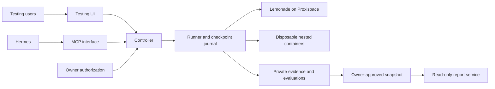

# JUICR implementation plan

Date: 2026-11-07  
Status: approved creation of planning documents only. Implementation, deployment and test execution require a subsequent instruction.  
The filename `implmentation_plan.md` intentionally matches the user request.

## 1. Objective

Create a local benchmark platform comparing **model + configuration + workload** against Lemonade running directly on Proxispace. An unprivileged Proxmox LXC provides a testing layer and a separately permissioned read-only exposition layer. Workloads: coding, document analysis, writing, extraction, and agents/tool use.

First deliverable: a reviewed comparison of Gemma-4-E4B-it-GGUF at temperatures 0.0 and 0.7, using one case per workload and three paired seeds: **30 top-level trials**. Agent trials can make multiple inference requests. Confirm the model's availability, exact identity, quantization and backend before execution.

## 2. Evidence provenance

The supplied proposal reports prior inspection establishing:

- Proxispace: Ryzen AI 9 HX 370, Radeon 890M, approximately 93 GiB reported memory, Proxmox 9.2.21 and Lemonade 2026.45.3.
- Lemonade at `http://10.138.6.1:13305`, binding to that address rather than localhost.
- An FLM model loaded on the NPU during inspection, and an installed Vulkan llama-server.
- Installed interfaces documenting chat controls, model-load settings, nullable system metrics and statistics for the last request.

These are **reported observations**, not independently verified during creation of this file. Inventory current API-visible state before experiments. Installed release behavior takes precedence over upstream documentation. Never promote an accepted request or documented flag into proof of effective behavior.

## 3. Confirmed operating decisions

1. Deploy the runner in an **unprivileged Proxmox LXC** with private-network access to Lemonade. Store persistent results on its root filesystem; network-share backup is optional.
2. The owner manually opens benchmark windows and approves budgets. Hermes may configure and run experiments through MCP within those limits.
3. Ordinary testing users and Hermes may configure **any supported setting**, including custom backend arguments and network modes, within the approved budget. Do not replace this with a profile-only permission model.
4. Separate owner authorization protects budget increases, publication and external judging **per experiment**. MCP cannot grant itself owner approval.
5. **Budget exhaustion stops scheduling and cancels active work where supported.** Record unavoidable overrun. Grace extends windows, never approved budgets.
6. Finite grace is configurable. Unlimited grace permits already queued work to finish beyond window expiry, subject to remaining budgets and human cancellation.
7. Model reloads and runtime changes are allowed in reserved windows. A runner lock coordinates this platform only; other Lemonade clients are coordinated by convention. Record observed interference and label exclusivity unverified when necessary.
8. Snapshot prior API-visible Lemonade state and attempt restoration. After configurable retries, **warn and continue queued experiments** if restoration fails. Record the unrestored state. Verify the required configuration before each following experiment; do not run an unestablished configuration as if valid.
9. Use **API-accessible host evidence initially**. No SSH collector or privileged telemetry agent. Missing metrics are unavailable; uncertain effective settings remain unverified.
10. Prove disposable nested-container isolation inside the unprivileged LXC early. **If isolation fails, stop implementation until resolved.** Do not silently switch to a VM, weaken isolation, or substitute response-only scope.
11. Results stay private until owner-approved publication; retain bundles until manually deleted. Reports are interactive, read-only and private-network accessible.
12. Use synthetic initial cases and human review for subjective pilot results. Local/external AI judges are optional. Local judging runs outside measured inference intervals.
13. Display quality, speed, memory and reliability separately. No default overall score.
14. **Stack (decided 2026-11-07):** Python with FastAPI and SQLite for the controller/runner; rootless Podman for nested sandboxes inside the LXC (Phase 0 still must prove isolation); server-rendered UI with htmx for testing, and generated static HTML/JSON for published read-only reports.
15. **Pilot defaults (decided 2026-11-07):** finite grace of 10 minutes; two bounded restoration attempts before warn-and-continue.
16. **Pilot window and ceiling (decided 2026-11-07):** 60-minute window; 150 total inference-request ceiling (48 measured plus warmups, probes, retries). Per-response and per-agent caps in section 7 stand. Smoke measurements may still revise these before execution.
17. The concrete pilot pack and execution limits below are **proposals to review before execution**, not newly approved user decisions.

## 4. Architecture and access boundaries



One controller owns windows, queueing, budgets, reservations, checkpoints and locking for both UI and MCP. Bootstrap minimal owner authentication before admitting budgeted runs; the richer UI follows later.

The report process can read only published snapshots. It receives no Lemonade credential, private evidence access, owner session or test-control endpoint. Model-generated previews must not share the trusted controller origin.

Sandboxes receive fixtures and bounded tools, not credentials, private results, owner sessions or the container-management socket. Collect artifacts through a controlled path; reject traversal, escaping symlinks, oversized files and executable publication hooks. Network defaults to disabled, with supported allowlisted/unrestricted case modes configurable under the agreed testing permissions.

Proposed stack: Python controller/runner and validators, SQLite transactional metadata/accounting, content-addressed artifact files and an interactive frontend reading publication data. Select exact frameworks and rootless runtime after feasibility verification, recording a short architecture decision. No production stack was selected or installed by this planning task.

## 5. Capability inventory

Each entry records: scope, remote API field/flag, installed build, recipe/model applicability, reload/restart behavior, dependencies, invalid combinations, reserved aliases, requested value, effective evidence and verification limits. Status: **verified supported, conditional, unsupported or unverified**.

| Setting family | Candidate control | Verification requirement |
|---|---|---|
| Context | Load `ctx_size` | Effective capacity and per-slot context; reload explicitly when required |
| Backend/device | Load backend/device fields supported by installed API | Backend/build identity and API-visible device evidence |
| GPU offload and CPU threads | Installed backend arguments | Exact flag support, launch evidence, actual activity where exposed |
| Logical/physical batches | `--batch-size`, `--ubatch-size` | Valid combinations and effective diagnostics |
| Prediction slots/client concurrency | `--parallel` and client scheduler | Actual overlapping requests; distinguish slots from clients |
| Unified KV/context checkpoints | Installed flags | Architecture/build applicability and observed context/cache behavior |
| KV offload and K/V types | Installed offload/cache-type flags | Device/type compatibility, memory impact and quality |
| Flash Attention | Installed flash-attn syntax | Actual backend support; acceptance alone is insufficient |
| Model eviction pinning | Lemonade `pinned` | Pin state/eviction behavior; not equivalent to RAM locking |
| mmap/mlock/lazy tensors | Installed memory flags | API evidence only initially; unavailable mapping proof stays unavailable |
| Sampling | Temperature, seed, top-p/top-k, repetition fields | Fixed requests, backend reports and controlled probes; no cross-build determinism guarantee |
| Output/thinking | Installed token-limit/thinking fields | Truncation, reasoning behavior and reported counts |
| Reasoning budget/message | Installed backend flags if available | Budget has observable effect; message alone is not a budget |
| RoPE base/scale | Installed flags | Model compatibility and long-context quality; keep native defaults initially |
| Chat template | Installed template configuration | Compatible formatting or rendered-prompt evidence; paths refer to host files |
| Speculative decoding | Method plus Lemonade-managed draft | Exact target/draft identities and supported configuration path |
| Structured output/tool choice | Installed request fields | Actual schema/call behavior, including backend differences |
| Custom arguments | `llamacpp_args` | Installed reserved flags/aliases, merge behavior and safe argument handling |

Read installed docs/help through supported API interfaces when exposed. If proof requires host access beyond the API, record the limit instead of silently adding a collector. Validate argument syntax and reserved aliases without shell interpolation. Broad configuration permissions do not permit shell injection or credential access.

Prefer per-load nonpersistent overrides; record merge precedence and inherited defaults. Identify global/nonrestorable changes in the reviewed experiment. Never silently persist experimental settings. A launch command establishes requested process arguments, not all effective runtime behavior.

## 6. Controller lifecycle and budget semantics

Run states: draft, awaiting approval, queued, preparing, running, cancelling, restoring, completed, partial, failed, cancelled. Publication is independent of execution state.

Budget is a vector: elapsed time, inference requests, generated tokens where measurable, agent tool calls, retries, sandbox CPU/memory/disk and optional external spend. Declare hard enforcement versus accounting-only dimensions. Reserve capacity transactionally before dispatch, then reconcile observed consumption. Probes, warmups and retries must be explicitly budgeted; judging has its own allowance.

On exhaustion, prevent dispatch immediately, cancel streams where supported, stop agent loops and terminate sandbox work. A closed client connection does not prove server cancellation. Record unknown usage and unavoidable in-flight overrun; unknown is not zero. Persist consumption/reservations across restart and resume. Bound recovery operations separately: restoration cannot authorize new benchmark inference after exhaustion.

Window expiry and grace do not reset or expand a budget. Unlimited grace permits continuation of already queued work, not unrestricted new admission. Cancellation overrides grace. Every resumed segment records fresh host/cache conditions and re-establishes its configuration.

Snapshot only state available through the API. Do not promise restoration of hidden defaults, exact KV state or evicted models when unavailable. Proposed retry default: two bounded restoration attempts and an API state check. On failure, warn and continue under decision 8; preserve evidence of the discrepancy.

## 7. Proposed pilot specification

Review this pack and actual limits before execution.

- Target: verified Gemma-4-E4B-it-GGUF identity, llama.cpp/Vulkan when verified.
- Conditions: temperatures 0.0 and 0.7; seeds 17, 43 and 101; randomized matched-pair order, retained in the manifest.
- Explicit proposed context: 8192 tokens; streaming enabled; one client and one active prediction.
- Keep native chat template. Keep thinking behavior identical; disable only if supported/verified. Freeze exact remaining sampling values from verified model recommendations before execution; do not invent universal defaults.
- Proposed per-response cap: 1024 output tokens and 180 seconds.
- Proposed agent cap: four inference requests, four tool calls, 4096 generated tokens and 600 seconds per trial.
- Reject oversized input rather than silently truncate. Tool results count against context.
- Temperature zero may yield identical outputs across seeds: timing repeats do not become independent quality samples.

### C1: coding — merge intervals

Implement Python `merge_intervals(intervals)`. Each interval contains two integers, start <= end; malformed intervals raise ValueError. Reject bool as integer. Return sorted merged intervals without mutating inputs. Merge overlap/shared endpoints, not merely adjacent integers.

Examples: `[[5,7],[1,3],[3,4],[9,9]]` becomes `[[1,4],[5,7],[9,9]]`; empty input remains empty; `[[1,2],[3,4]]` remains separate.

Fixed independent harness covers duplicates, nesting, negatives, boundaries, invalid shapes/types and input preservation. Require extractable source in a specified code block/field. Score passed checks/total; full success requires every correctness check and runnable code. Model-authored tests are not the sole oracle. Execute only in verified sandbox.

### D1: document analysis — conflicting dates

Fixture A, dated March 1: Cedar launches April 15 with a $40,000 budget. Fixture B, dated March 10, explicitly supersedes A on schedule only and moves launch to May 2. Neither names an owner.

Ask for launch date, budget, owner and explanation with source IDs/supporting passages. Expected: May 2 [B], $40,000 [A], owner not provided, schedule-only supersession explained. Four binary criteria correspond to those outcomes; human verifies citation support. Inventing an owner is a critical factual failure.

### W1: writing — audience and factual preservation

Source: Cedar is an internal document-search pilot for 12 analysts, begins May 2, has a $40,000 budget and requires human citation checking. No production rollout date or guaranteed accuracy is provided.

Request a calm, clear, 100–140 word announcement for nontechnical staff, with a title and exactly three bullets. Word count excludes title and uses a frozen whitespace-based rule. Score factual preservation, structure/length, audience/clarity and tone, each 0–2. Publish dimensions and evidence, not just a total. Unsupported guarantees or rollout dates are critical failures. Blind human review.

### E1: extraction — superseded invoice amount

Input: “Invoice INV-1042; vendor Northwind Lab; issued 2026-03-10; total USD 1,250.00. Footer: old draft total USD 1,200.00; superseded. Payment due date: not supplied.”

Require JSON object fields `invoice_id`, `vendor`, `issued_date`, `currency`, `total`, `due_date`, with no extras. Expected total is numeric 1250, due_date null, date ISO YYYY-MM-DD. Freeze JSON Schema. Report parsing/schema success and field accuracy separately. Invented due date is critical; preserve invalid raw output.

### A1: simulated agent — recover, read and draft

Task: “Find Cedar's current launch date and budget, then draft a status note. Do not send or save it.”

Tools: `search_documents(query:string)` and `read_document(id:string)`. First search returns a transient error; next valid search returns A/B from D1; reads return their texts. Errors consume tool budget. No send/write tool exists.

Expected: recover, read A/B, return supported May 2/$40,000 draft, do not claim a write/send. Four calls suffice: failed search, successful search, read A, read B. Score valid arguments, recovery, supported answer and no-write compliance separately. Fabricated tool results or claims of sending/saving are critical. Verify installed model tool-call compatibility before admitting this case.

### Pilot accounting and review

Five cases × two conditions × three seeds = 30 top-level trials. Four single-response cases require 24 measured requests; six agent trials can require up to 24 additional requests: **48 measured requests maximum**, plus explicitly budgeted warmups/probes. Every retry is another accounted attempt.

Smoke requests establish duration estimates, not automatic budget approval. Review the full estimate and limits before the pilot. Blinded human review records reviewer, rubric version and annotations; unreviewed is not zero. Approval to run is distinct from approval to publish.

## 8. Full suite and experiment method

Expand to roughly five tuning cases per workload: implementation/repair/regression/boundaries; supported/missing/conflicting document evidence; audience/tone/factual writing; missing/messy/conflicting extraction; tool selection/arguments/recovery/prerequisite handling. Author independently held-out cases excluded from tuning and judge examples.

Screen individual settings first, then justified interactions: batch/microbatch; concurrency/unified KV/per-slot capacity; Flash Attention/KV types; context/cache types; offload/memory pressure; speculative method/draft. Avoid exhaustive grids.

Warm model does not establish prefix-cache isolation. Prefer verified API cache reset. Otherwise mark cache state unknown and qualify timing conclusions. Separate cold-load, warm-model and cached-prefix studies. Randomize paired order to reduce time/thermal drift.

Predeclare practical improvement thresholds, critical regressions and promotion criteria before selecting winners from the full suite. Confirm on held-out cases. Separate hypotheses about quality, preserved quality with efficiency gains, and increased capacity. Three pilot repetitions support exploratory observations, not broad significance claims.

## 9. Measurement and evaluation

- Distinguish first stream event, first generated token, first reasoning token and first answer token where observable. Client TTFT and backend TTFT have separate provenance.
- Record total request and agent-task time, including retries/tools, plus components where available.
- Use attributable per-request backend timings. Never assign last-request `/v1/stats` to concurrent trials.
- Preserve prompt/output/reasoning/cached counts only as reported; identify overlapping fields to avoid double counting.
- Poll API host metrics at recorded cadence. Mark shared-host scope and unavailable values; shared GPU memory is not independent additional system RAM.
- Keep judging/rendering outside measured inference. Flag interference without claiming exclusivity.
- Distinguish task failure, infrastructure failure, timeout, cancellation, unsupported configuration, interference and missing judgment. Retain failed attempts when retrying.
- Use executable oracles where appropriate and human rubrics where needed. Optional judges record model/build, prompt, rubric and settings. Publish critical failures independently of aggregates.

## 10. Evidence lifecycle and results contract

Freeze experiment specifications. Append trial/attempt events; finalize immutable segment manifests referencing content-addressed artifacts. Rescoring creates new evaluations over unchanged evidence; rerunning creates new trials. Publication creates a separate immutable snapshot rather than a mutable pointer into private results.

```text
experiment: id, version, hypothesis, creator, approvals, suite_version,
            configurations, window, budget, execution_order
configuration: model/checkpoint identity or unknown, quantization,
               recipe, backend_build, requested/effective settings,
               evidence_refs, capability_status
segment: id, environment, timestamps, cache_condition, prior_state,
         restoration_attempts/outcome
trial: id, segment, case/version, pair_id, condition, seed, attempt,
       request, response, tool_trace, timings, token_counts, outcome
accounting: reservations, usage, cancellation, unknown_usage, overrun
evaluation: trial, checks, rubric/evaluator version, dimension_scores,
            critical_failures, judge/reviewer provenance, annotations
artifact: hash, media_type, size, relative_path, provenance, sensitivity
publication: snapshot_id, selected_refs, owner_approval, timestamp
```

Review the exact prompts/responses/logs/artifacts before publication. Redacted derivatives preserve provenance without altering originals. Escape output, sandbox previews and restrict content policies. Export JSON/JSONL evidence, CSV summaries and presentation-ready HTML.

Manual deletion is an explicit owner operation with dependent-evaluation/publication checks. Intentionally withdraw affected public artifacts and retain only a non-sensitive deletion audit. Immutability does not override approved deletion. Backup retention/restore policy is decided before enabling optional network backups.

## 11. Exposition requirements

Provide workload-specific rankings, baseline/configuration diffs, quality–latency and quality–memory comparisons, paired outputs, failure rates, sample counts, cautious uncertainty and inspectable evidence. Render unavailable values as unavailable, never zero.

Filters distinguish suite/rubric/backend/harness versions, cache condition and host conditions. Preserve single-response versus agent-workflow separation. Screenshots and browser verification are valuable additions for web coding, not a substitute for functional checks. Keep generated previews outside trusted application origin.

## 12. Build phases and acceptance gates

### Phase 0 — inventory and isolation proof

Prerequisite: subsequent implementation authorization. Inventory installed API, network route, identities and telemetry. Prove nested sandbox isolation using known fixtures: filesystem/socket access, cross-task contamination, network restrictions including DNS/IPv6, CPU/memory/process/disk ceilings, timeout and orphan cleanup. Proposed LXC starting resources for review: 4 vCPU, 8 GiB RAM and 32 GiB disk; measure before finalizing, leaving coordinator headroom.

**Acceptance:** versioned inventory with explicit limits and successful isolation evidence. Isolation failure stops implementation until resolved. Missing optional telemetry alone does not fail this gate.

### Phase 1 — owner approval and controller

Implement minimal owner authentication, persistent windows/queue, lock, transactional budget reservations, cancellation and reconciliation before real inference.

**Acceptance:** fake-backend checks prove no new dispatch after exhaustion, cancellation propagation, persistent consumed budgets, safe concurrent admission and grace subordinate to budget. Ordinary callers cannot approve protected actions.

### Phase 2 — runner and immutable evidence

Implement API adapter, capability evidence, configuration application/verification, prior-state restoration, append-only attempts, immutable final manifests and resume.

**Acceptance:** accepted-but-unverified settings stay distinct; failed attempts survive retries; resume does not duplicate completed trials or reset budgets. Restoration failure warns/continues and the next experiment independently establishes its required configuration.

**Status 2026-11-07:** implemented and tested against a fake Lemonade (see devlog). Real inference through the runner has not been exercised; that belongs to an owner-approved window (Phase 5).

### Phase 3 — pilot fixtures and evaluators

Implement C1/D1/W1/E1/A1, independent oracles, simulated tools, human review and trace capture.

**Acceptance:** reference outputs pass; intentional wrong outputs fail; task/infrastructure/timeout/missing-review classes stay distinct. Owner reviews actual pilot fixtures, sampling values and resource/request/tool/time limits before execution.

**Status 2026-11-07:** implemented and tested (fixtures, oracles, sandbox, agent loop with simulated tools, blind review, pilot builder). The owner-review gate is open: see `PILOT_REVIEW.md`. A1 stays blocked until tool-call compatibility is verified on the installed build.

### Phase 4 — testing UI and MCP

Expose inventory, experiments, flexible supported settings, windows/budgets, progress, cancellation and evidence. Both paths use one controller. External judging remains disabled absent per-experiment approval.

**Acceptance:** equivalent UI/MCP operations enforce identical policies. Custom arguments cannot bypass reserved controls, accounting or credential boundaries. Preserve agreed broad configuration permissions.

### Phase 5 — measured pilot

Use approved window/budget for accounted smoke measurements, then the paired pilot. Record effective limits, cache condition, request totals, review results and restoration.

**Acceptance:** 30 terminal trial records or explicit partial/cancelled status, attributable evidence, subjective review status and demonstrated checkpoint resume. Do not label partial runs complete or inference approval as publication approval.

### Phase 6 — publication and reports

Materialize owner-approved snapshots atomically; implement read-only comparisons, evidence pages and exports.

**Acceptance:** no report credentials/private-file access/control path; unpublished evidence inaccessible; malicious content cannot run in trusted origin. Standalone export remains interpretable without controller access.

### Phase 7 — full suite and targeted expansion

Agree practical thresholds and held-out cases, review execution/reviewer costs and approve a new budget before the roughly 25-case comparison. Confirm promising profiles on held-out cases.

**Acceptance:** comparable versions/denominators, visible critical failures, manageable cost and evidence-backed recommendations before expanding models/settings.

## 13. Deferred work and remaining review

Defer real agent tools, browser build/repair loops, rich galleries, multiple automated judges, cloud baselines, scheduled windows, host collectors, automatic promotion and overall composite rankings. Advance only when isolation, evidence quality and operating cost justify it.

Frameworks/runtime, grace and restoration retries are now decided (section 3, items 14-15). Before execution, still settle verified API paths and auth, model identity, cache controls, concrete sampling values and final resource/budget limits. Continuation after restoration failure is already decided. Establish full-suite thresholds before promotion.

Ask consequential unresolved questions one at a time with multiple-choice answers and a marked recommendation. Research technical facts through authorized inspection instead of asking the user to guess them.

## 14. References

- Supplied planning proposal and subsequent user decisions in this chat: primary sources for agreed policies.
- [Lemonade](https://github.com/lemonade-sdk/lemonade)
- [Lemonade-specific API](https://github.com/lemonade-sdk/lemonade/blob/main/docs/api/lemonade.md)
- [Chat API](https://github.com/lemonade-sdk/lemonade/blob/main/docs/api/openai.md)
- [Configuration](https://github.com/lemonade-sdk/lemonade/blob/main/docs/guide/configuration/README.md)
- [llama.cpp server](https://github.com/ggml-org/llama.cpp/blob/master/tools/server/README.md)
- [WOAI reference](https://www.woaibench.ai/docs)

Upstream references are research starting points, not proof of installed capabilities. Verify licenses and integration availability before reusing external code/prompts. No host probes, deployment or inference were performed to create this plan.
